## Hi, I'm Aryan 👋

Computer Science student at **Rajalakshmi Engineering College** (B.E. CSE, 2023–2027) who builds practical systems: full-stack web apps, retrieval-augmented AI pipelines, and tools for real-world civic problems.

## Focus

- **Full-stack engineering**: React front ends backed by cloud services
- **AI / RAG systems**: multi-agent pipelines with grounded, cited answers
- **Cloud**: AWS (Cognito, IAM, RDS)
- **Applied AI**: civic and agricultural problems; on-device ML inference

## Experience

**Software Engineering Intern, PAPL Corp** · June 2026

- Built core frontend modules of a multi-tenant SaaS performance management system in React: appraisal workflows, goal tracking and org hierarchy views
- Implemented secure authentication and role-based access control with AWS Cognito and IAM
- Connected the app to AWS RDS for scalable, normalized storage of appraisal cycles, goals and audit logs

## Featured Projects

| Project | What it is | Stack |
| --- | --- | --- |
| **Multi-Agent Enterprise Knowledge Analyzer** | Multi-agent RAG pipeline (LangGraph) answering questions grounded in uploaded PDFs with page-level citations; token-aware chunking and guardrails against hallucination and prompt injection | Python, LangGraph, ChromaDB, Claude API, Streamlit |
| **Crowdsourced Civic Issue Reporting System** | Mobile-first civic issue reporting with photo, location and voice-note capture; AI categorization, voice transcription, QR/NFC tagging, geofencing and workforce assignment | Flutter, Firebase, Flask, TensorFlow, MongoDB, React |
| **AEGIS** | Autonomous software engineering and incident-response platform | — |
| **NexusCRM** | Explainable, event-driven AI CRM prototype for small telecom operators (capstone) | Next.js, TypeScript, FastAPI, scikit-learn / XGBoost, Prisma |

## Engineering Stack

**AI / ML:** LangChain · LangGraph · RAG · Vector DBs (ChromaDB) · Claude API

## Certifications

- Anthropic — Building with the Claude API
- Google — AI Professional Certificate
- Oracle Academy — PL/SQL Learner
- Infosys Springboard — Front End Web Developer

## GitHub Activity

  
  

## Connect

